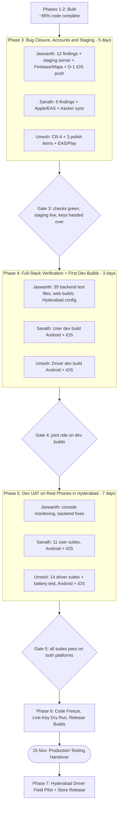

# MyDriver — PRD: SDLC Master Plan, Audit & Product Requirements

> **How to use this file:** This is the team's single source of truth (updated 25 Oct 2026, branch `production-p1` at `de02abc`).
> - **Parts 1–5:** how we deliver — the audit, who works together how, and the phase plan to the Nov 15 handover.
> - **Part 6:** what we build — the original Phase 1 product requirements, unchanged.
> - **Status:** day-to-day status is in [tasks.md](tasks.md), session notes in [progress.md](progress.md).
>
> Update this file when a phase gate passes or a decision is made.

> [!IMPORTANT]
> **Goal:** Hand over a **working production-testing prototype by November 15th** — live Website + Operations Console + backend, and installable **Customer** and **Driver** apps on **both Android and iOS** — for a **Hyderabad** rollout.
>
> **Verdict: Feasible, with conditions.** Roughly 95% of the code is already on `production-p1` (`de02abc`), so it's feasible. The real risks are elsewhere: Jaswanth carries too much of the critical path (§3.3), outside accounts take days to approve (especially Apple — §4), and iOS push notifications don't work yet (decision D-1). If those three are handled in the first week, Nov 15 is realistic.

### Agreed Testing Model (from Sanath, 25 Oct)
| Question | Answer → What it means for the plan |
| :--- | :--- |
| Platforms | **Android + iOS** → Apple Developer account, iOS builds, iOS push (D-1) and TestFlight are now on the critical path. |
| Who tests | **The 3 devs test before launch; Hyderabad drivers test after launch** → Phase 5 = dev UAT, Phase 7 = driver field pilot. |
| City | **Hyderabad** → service area, rate cards, place search and test routes (incl. RGIA airport) must be set up for Hyderabad. |
| Payment / KYC keys | **Test keys until launch, plus one live run with live keys just before launch** → Phase 6 has a "Live-Key Dry Run" step. |
| Bug reports | **Testers call or text the devs** → the dev who receives the call or text logs it in one shared bug log (§3.5) so nothing gets lost. |

---

## Part 1: Audit of Existing Planning Documents

| Document | Purpose & Scope | Current State / Limitation |
| :--- | :--- | :--- |
| [prd.md](prd.md) — Part 6 | Phase 1 product requirements (booking, payments, dispatch, handshake, Trip Vault, L0–L5 safety, Night Shield, Ops Console). | Accurate. It said *what* to build but not *how* to deliver it — which is why this plan (Parts 1–5) was added on 25 Oct. |
| [tasks.md](tasks.md) | Per-owner checklist (Sanath / Umesh / Jaswanth). | Was 3 commits behind; **brought up to date on 25 Oct** and now follows the phases in this file. |
| [progress.md](progress.md) | Reverse-chronological session diary. | Was 3 commits behind (6 of its 7 "open" findings were fixed on 24 Oct); **a 25 Oct entry now records the review and this plan.** |
| [driver-app-testing.md](docs/driver-app-testing.md) & [user-app-testing.md](docs/user-app-testing.md) | Phone test checklists (14 driver suites, 11 user suites). | Good and usable as-is → these are the Phase 5 checklists. |
| [production-cost-analysis.md](docs/production-cost-analysis.md) & [handoff-polling-fixes.md](docs/handoff-polling-fixes.md) | Cost model, polling/Redis design. | Complete and implemented. |
| [backend-implementation-plan.md](docs/backend-implementation-plan.md) & [docs/superpowers/specs/](docs/superpowers/specs) | Aug–Oct design specs. | Historical — already implemented (migrations `0001`–`0020`). |

---

## Part 2: Verification of the New Pull (`d640d2d` → `de02abc`)

7 commits, 70 files (+2,337 / −626), migrations `0018`–`0020`.

| Commit | Author | Key Changes Verified in Code |
| :--- | :--- | :--- |
| `bd0d854` | Umesh | Driver onboarding gate ([onboardingGate.js](prototype/mobile/driver/src/lib/onboardingGate.js)) + 11 unit tests; website PlacePicker z-index, multi-stop/round-trip pricing in [fare.ts](prototype/backend/src/modules/trips/fare.ts), `ESCALATED`/`NO_DRIVERS_FOUND` handling in [TripContext.jsx](prototype/website/src/context/TripContext.jsx). |
| `52c609f` | Jaswanth | Migration `0018`: `amount_due` second order, `DRIVER_ARRIVED` within 150 m, practical test scheduling; GPS billing filters + fare cap + mock-GPS flag; `SUBSCRIBE_OPS` live console feed ([ops-feed.ts](prototype/backend/src/realtime/ops-feed.ts)). |
| `cd9de9c` | Jaswanth | Migrations `0019`/`0020`: server-side tier from car ([tier.ts](prototype/backend/src/modules/trips/tier.ts)), console-editable fees ([fees.ts](prototype/backend/src/modules/trips/fees.ts)), customer safety defaults, website map picker + Photon geocoder, auto-offline after 2 missed offers. |
| `1897e6f` | Umesh | Docs: progress/tasks/testing guides with 7 review findings. |
| `31c72a0` | Jaswanth | Console onboarding decisions pushed to Driver App over WebSocket; fined-trip labels in Earnings; 2-hour minimum hourly hire in User App. |
| `bc34996` | Jaswanth | Driver App reads `platform_fee` from `/v1/catalogue/trip-config` (no hardcoded ₹19). |
| `de02abc` | Jaswanth | Removed `SkillPicker.jsx` (User App); safety-defaults prompt; `DRIVER_ARRIVED` banner; "Pay ₹X" on Vault receipts; removed fake "Verified" placeholders; Redis fast path in `listPendingOffers()`. |

---

## Part 3: How the Three of You Work Together

### 3.1 Who owns what (no merge conflicts)
| Developer | Owns | Never edits without telling the owner |
| :--- | :--- | :--- |
| **Jaswanth** | `prototype/backend/`, `prototype/website/`, `prototype/shared/`, `deploy/` | `prototype/mobile/*` |
| **Sanath** | `prototype/mobile/user/`, `prototype/mobile/proto/` (to be deleted), tracker docs (`tasks.md`, `progress.md`, this plan) | backend, website, driver app |
| **Umesh** | `prototype/mobile/driver/` | backend, website, user app |

- **Contract first:** any change to an API or WebSocket payload is merged by Jaswanth **before** the apps rely on it. Only Jaswanth edits [api-client.js](prototype/shared/api-client.js), and he syncs it into all three apps in one commit.

### 3.2 Git rules
1. Run `git pull --rebase` before every push to `production-p1`. Commit messages start with the finding ID, e.g. `fix(CR-4): …`.
2. **Code freeze at the end of Phase 6 Step 1.** After that, only fixes for bugs found in the dry runs go in.
3. When you hand over, tag the release, e.g. `v0.9.0-prodtest`, so everyone knows exactly which code the testers have.

### 3.3 Spreading Jaswanth's load
In the earlier plan Jaswanth was on the critical path for every phase. Changes:
- **The staging server goes up in Phase 3 with the current code** and is redeployed as fixes land. It no longer waits for Phase 5.
- **Sanath and Umesh each register their own app** in the shared Firebase project and EAS/Apple setup. Jaswanth only creates the projects and adds them as members.
- **Sanath owns the tracker sync** (`tasks.md`, `progress.md`, the shared bug log).

### 3.4 Joint test at every gate (30 min, all 3 together)
Run **one full ride**: Customer books → Console sees it live → Driver gets the offer and accepts → Arrived → selfie + 4-digit OTP → 8-photo pre-inspection → drive → SOS → Console resolves → both apps return to `IN_TRIP` → post-inspection → Complete → customer pays any `amount_due`.
- **From Phase 5 onward, run it once on Android and once on iOS.**

**If a gate fails:** the owner of the failing part fixes it **within 24 hours**, and the whole test is re-run. The next phase doesn't start until the joint test passes. Lanes that aren't affected can keep working on their own items in the meantime.

### 3.5 Bug intake (calls / texts → one log)
Testers call or text whichever dev they know. **That dev logs the bug in a shared bug log the same day** (a Google Sheet or GitHub Issues):

| Field | Example |
| :--- | :--- |
| ID / date / reporter | `B-014`, 4 Nov, driver Ravi |
| Surface | User App · Driver App · Website · Console · Backend |
| Platform & phone | iOS 18 / iPhone 13 |
| Severity | **P0** blocks a ride or payment · **P1** wrong data or confusing · **P2** cosmetic |
| Owner / status | Umesh / Fixed in `a1b2c3d` |

- **10-minute triage every day:** P0 → fix the same day. P1 → before the next gate. P2 → after handover.

---

## Part 4: Day-1 External Accounts & Decisions (start on Day 1, they're slow)

> [!WARNING]
> These depend on third parties. Not code work, but each can take **1–5 days**. Start all of them on Day 1.

| # | Item | Owner | Why it's urgent |
| :--- | :--- | :--- | :--- |
| X-1 | **Apple Developer Program** (organisation account, US$99/yr) + App Store Connect | Sanath (Umesh added as member) | Org enrolment needs a D-U-N-S number and can take days. **iOS builds, iOS push and TestFlight all depend on it.** |
| X-2 | **Expo / EAS organisation** with both projects; Apple credentials linked | Sanath (user app), Umesh (driver app) | Needed for every Android and iOS build. |
| X-3 | **Firebase project** — 6 Android apps (`com.mydriver.user`/`.preview`/`.dev`, `com.mydriver.driver`/`.preview`/`.dev`) + matching iOS apps; APNs key uploaded | Jaswanth creates it; Sanath & Umesh register their own apps | `google-services.json` / `GoogleService-Info.plist` are needed to build. |
| X-4 | **Google Maps keys** (Android + iOS, restricted by package / bundle ID) | Jaswanth | Native maps in both apps. |
| X-5 | **Server + domain + DNS** for staging (`api.`, `admin.`, web) | Jaswanth | Phones must reach the backend over HTTPS on mobile data. |
| X-6 | **Razorpay & Cashfree live activation (KYC)** — test keys for now | Jaswanth | **Live activation can take days.** It must be ready before the Live-Key Dry Run in Phase 6. |
| X-7 | **Google Play Console** account (one-time $25) — internal testing track | Umesh | Lets Android testers install builds easily after launch (optional for devs, who can use the APK directly). |

### Decisions to settle in Phase 3
| # | Decision | Owner | Recommendation |
| :--- | :--- | :--- | :--- |
| **D-1** | **iOS push.** On iOS the apps register a raw APNs token, but the backend sends through FCM ([fcm.ts](prototype/backend/src/providers/push/fcm.ts)), so iOS pushes fail — and finding M-6 then deletes the token. | Jaswanth + Sanath + Umesh | Add an **APNs provider in the backend** (`providers/push/apns.ts`, chosen by token platform). The mobile apps stay as they are. Fix M-6 in the same change. **Without this, the driver offer ring won't work on iPhones.** |
| **D-2** | **How iOS testers get the app** | Sanath + Umesh | **TestFlight.** Devs = internal testers (no review). Hyderabad drivers = external testers (one Beta App Review, usually under 48 h — submit by the end of Phase 5). |
| **D-3** | **Driver vehicle fields:** `vehicle_model` / `vehicle_plate` are currently required to go online, even though drivers drive the customer's car | Umesh + Jaswanth | Make them optional — only `full_name` required. |
| **D-4** | **Hyderabad setup:** service area / dispatch centre, rate cards and fees in Console `Pricing`, place-search bias towards Hyderabad | Jaswanth | Configure on staging during Phase 4. Check during the Phase 5 road tests. |

---

## Part 5: Phase Plan

**Soft time budgets.** These are targets, not deadlines. Day 1 = Mon 26 Oct; handover is Sun 15 Nov, about 21 days. If a phase overruns, the buffer absorbs it. **If the buffer runs out, cut scope from Phase 7 — never from the gates.**

| Phase | Budget | Rough window |
| :--- | :--- | :--- |
| 3 — Bug closure, accounts & staging | 5 days | 26 – 30 Oct |
| 4 — Full-stack verification + first dev builds | 3 days | 31 Oct – 2 Nov |
| 5 — Dev UAT on real Android & iOS phones in Hyderabad | 7 days | 3 – 9 Nov |
| 6 — Freeze, Live-Key Dry Run & handover | 3 days | 10 – 12 Nov |
| Buffer | 3 days | 13 – 15 Nov → **Handover 15 Nov** |
| 7 — Hyderabad driver field pilot | after launch | from 16 Nov |

---

### Phase 1: Foundation, Database, Auth & Dispatch — ✅ DONE
- [x] Fastify 5 + TypeScript + Zod, PostgreSQL 16 / TimescaleDB, PgBouncer, Redis 7, MinIO/S3, migrations `0001`–`0020`.
- [x] Phone OTP (argon2, 5-attempt limit), Google Sign-In, staff RBAC, rotating refresh tokens.
- [x] 5 km Redis GEO dispatch, 20 s offer TTL, 3 rounds, zero-Postgres idle polling.
- [x] Selfie liveness + 4-digit OTP handshake, 8-zone inspections with watermarks, signed PDF certificates.
- [x] Dual-GPS integrity engine, L0–L5 escalation, Silent SOS.
- [x] Cashfree KYC; Razorpay hold / capture / arrival fee / `amount_due` second order.
- [x] Shared [api-client.js](prototype/shared/api-client.js) synced to all three clients.

### Phase 2: Multi-Surface Features — ✅ CODE COMPLETE (fixes in Phase 3)
- [x] **Website & Console (Jaswanth):** marketing site, booking with map picker / multi-stop / round trip / safety defaults, live tracking, Guardian page, 14 console screens with live `SUBSCRIBE_OPS` feed.
- [x] **Customer App (Sanath):** OTP/Google auth, 3 booking tabs, multi-stop, car-based tier, safety defaults, Saved Garage, native maps, `DRIVER_ARRIVED`, pickup OTP, Hold-to-SOS + volume-button SOS, Trip Vault with "Pay ₹X".
- [x] **Driver App (Umesh):** OTP/Google auth, Cashfree KYC onboarding, server-validated onboarding gate, offer push channel + adaptive polling, handshake, 8-photo inspections with retry, background location + offline telemetry queue, Earnings / Assessments / Profile.

---

### Phase 3: Code-Review Bug Closure, Accounts & Staging — 🔄 CURRENT (≈5 days)
**Goal:** Close all **19 findings** from the 25 Oct code review (CodeRabbit + manual audit), start every item in Part 4, settle D-1 to D-4, and get staging live.

> [!NOTE]
> Finding IDs: **CR-#** = CodeRabbit finding #, **M-#** = manual audit finding #. They match the code review report and the three personal plans exactly.

#### 3A. Jaswanth — Backend, Website, Console
**Do first (Day 1–2), because the apps depend on these:**
- [ ] **M-1 (major):** add `stops`, `return_stops`, `vehicle_specs`, `vision_mode`, `flight_number`, `requirement`, `trip_type` to the `GET /v1/driver/offers` response schema in [routes.ts](prototype/backend/src/modules/trips/routes.ts#L474-L491). *Unblocks Umesh.*
- [ ] **M-4 (major):** publish `TRIP_STATE_CHANGED → IN_TRIP` in [`resolveEscalation()`](prototype/backend/src/modules/escalation/service.ts#L364-L374). *Unblocks Sanath and Umesh's SOS tests.*
- [ ] **CR-2 (major):** in [`setOnboardingStatus()`](prototype/backend/src/modules/admin-ops/service.ts#L301-L333), cancel the driver's `MATCHED` / `HANDSHAKE_PENDING` trips (no arrival fee charged) before taking an unapproved driver offline.
- [ ] **Staging server up** on current code (X-5), plus Firebase / Maps keys (X-3, X-4) handed to Sanath and Umesh.

**Then:**
- [ ] **CR-3 (major):** send reverse geocoding through `api.locations.reverse()` instead of the browser calling public Nominatim, in [PlacePicker.jsx](prototype/website/src/components/app/PlacePicker.jsx#L23-L53) (privacy fix).
- [ ] **M-3 (major):** "Pay ₹X balance" for `amount_due > 0` in website [Track.jsx](prototype/website/src/pages/dashboard/Track.jsx#L123-L196) and [Vault.jsx](prototype/website/src/pages/dashboard/Vault.jsx#L16-L129).
- [ ] **M-6 + D-1:** stop [fcm.ts](prototype/backend/src/providers/push/fcm.ts#L120-L135) deleting tokens on generic `400 INVALID_ARGUMENT`, and add the APNs path for iOS tokens.
- [ ] **Minor fixes:**
  - **CR-5:** guard `a.details?.tracked_km` in [TripDetail.jsx](prototype/website/src/pages/admin/TripDetail.jsx#L143-L147).
  - **CR-6:** block empty or negative inputs in [Pricing.jsx](prototype/website/src/pages/admin/Pricing.jsx#L109-L170).
  - **CR-7:** wrap saving the safety defaults in its own try/catch in [Book.jsx](prototype/website/src/pages/dashboard/Book.jsx#L118-L127).
  - **CR-8:** stop showing transmission/fuel as the number plate in [tripView.js](prototype/website/src/lib/tripView.js#L86-L90).
  - **M-7:** make active-trip rows clickable in [Board.jsx](prototype/website/src/pages/admin/Board.jsx#L137-L147).
  - **CR-9 / CR-11:** regenerate [api-documentation.md](api-documentation.md).
- [ ] **D-3** (with Umesh): if vehicle fields become optional, relax the `profile_complete` check in [driver-app/service.ts](prototype/backend/src/modules/driver-app/service.ts#L161-L165).

#### 3B. Sanath — Customer App
- [ ] **CR-1 + M-2 (major)**, in [booking.js](prototype/mobile/user/src/lib/booking.js#L580-L672):
  - send stops and return stops with `lat`/`lng`;
  - stop turning Within-City trips over 8 hours into `HOURLY`;
  - send `return_drop` for outstation round trips.
- [ ] **M-5:** show the `Stops fee` line in the quote breakdown in [HomeScreen.jsx](prototype/mobile/user/src/screens/customer/HomeScreen.jsx#L127-L159).
- [ ] **CR-7:** wrap saving the safety defaults and `refreshMe()` in their own try/catch so an error never blocks booking.
- [ ] **CR-8:** stop showing transmission/fuel as the plate in [mobile/user tripView.js](prototype/mobile/user/src/lib/tripView.js#L41-L45).
- [ ] **M-8 + CR-10:**
  - `git rm -r prototype/mobile/user/android prototype/mobile/proto`;
  - add `android/` and `ios/` to the user app's `.gitignore`;
  - update [user-app-testing.md](docs/user-app-testing.md).
- [ ] **Accounts:** X-1 Apple Developer, X-2 EAS (user app), register the user apps in Firebase (X-3).
- [ ] **Tracker sync:**
  - [x] `tasks.md` / `progress.md` brought in line with this plan (25 Oct).
  - [x] Plan moved into the repo as `prd.md` (25 Oct).
  - [ ] Set up the shared bug log (§3.5).

#### 3C. Umesh — Driver App
- [ ] **CR-4 (major — crash during live trips):** in `toRequest()` in [DriverContext.jsx](prototype/mobile/driver/src/context/DriverContext.jsx#L76-L107), never use `{lat,lng}` objects as `pickup`/`drop` text.
- [ ] **M-1 follow-up (after Jaswanth's M-1 lands):** keep the rich offer fields in `toRequest`, and check the offer card in [DriverHomeScreen.jsx](prototype/mobile/driver/src/screens/driver/DriverHomeScreen.jsx) on both the WebSocket and polling paths.
- [ ] **Onboarding auto-refresh:** while the driver is in `UNDER_REVIEW`, poll `/v1/driver/onboarding` every 10 s in [OnboardingScreen.jsx](prototype/mobile/driver/src/screens/driver/OnboardingScreen.jsx#L254-L266), so approval comes through even without push.
- [ ] **Test-runner hygiene:** remove the `MODULE_TYPELESS_PACKAGE_JSON` warning on `npm test`.
- [ ] **D-3** (with Jaswanth): make vehicle fields optional in [DriverFlow.jsx](prototype/mobile/driver/src/screens/driver/DriverFlow.jsx).
- [ ] **Accounts:** X-2 EAS (driver app), register the driver apps in Firebase (X-3), X-7 Play Console.

> 🤝 **Gate 3 — exit criteria**
> - [ ] All 19 findings committed, with the finding ID in each commit message.
> - [ ] `npx tsc --noEmit` (backend) passes, website `npm run lint` passes, both apps bundle with `npx expo export`, and the driver app's `npm test` passes (11/11).
> - [ ] Staging is live over HTTPS, and Firebase config files + Maps keys are with Sanath and Umesh.
> - [ ] D-1 to D-4 decided; X-1 to X-7 submitted (Apple approval may still be pending, but escalate it if it hasn't moved).

---

### Phase 4: Full-Stack Verification + First Dev Builds — ⏳ NEXT (≈3 days)
**Goal:** Prove the latest code works end to end **on real dev builds**. The apps can't do this in Expo Go: maps, push, volume-button SOS and background location all need a dev build.

| Developer | Responsibilities |
| :--- | :--- |
| **Jaswanth** | `npm run infra:up` → `npm run db:migrate` → backend `npm test` (**35 test files**). Website `npm run lint` + `npm run build` (customer + admin). Redeploy staging. Set up **D-4** Hyderabad service area, rate cards and fees on staging. |
| **Sanath** | `npx expo export` for both platforms with no errors. **Build user dev clients:** `eas build --profile development --platform android` and `--platform ios` (register test iPhones with `eas device:create`). Point them at staging. |
| **Umesh** | `npm test`, `npx expo export` for both platforms. **Build driver dev clients** for Android and iOS the same way. Point them at staging. |

> 🤝 **Gate 4:** Joint ride (§3.4) on the **dev builds against staging**, Android first. Smoke test on iOS if the Apple account is ready (otherwise iOS becomes a Phase 5 Day-1 item). Dev builds only need rebuilding when native code or config changes. JS fixes load from the dev server or an EAS Update.

---

### Phase 5: Dev UAT on Real Phones in Hyderabad — ⏳ (≈7 days)
**Goal:** The three devs run the complete phone checklists **on real Android phones and iPhones, on mobile data, on real Hyderabad roads**.

| Developer | Responsibilities |
| :--- | :--- |
| **Jaswanth** | Monitors the Console (Board, LiveMap, Incident, Drivers, Pricing) during road tests. Approves test KYC, schedules practical tests, resolves test SOS alerts. Fixes P0/P1 backend bugs same day and redeploys staging. |
| **Sanath** | All **11 suites** of [user-app-testing.md](docs/user-app-testing.md) **on Android and on iOS**: native map + live driver marker, push while locked, pickup OTP, Hold-to-SOS + volume SOS (check iOS behaviour separately), arrival fee, `amount_due` payment (Razorpay **test** mode), offline recovery, TalkBack/VoiceOver, large font, small screen. Run Hyderabad routes: a Within-City trip, an **RGIA airport** trip, a multi-stop trip, an outstation round trip. |
| **Umesh** | All **14 suites** of [driver-app-testing.md](docs/driver-app-testing.md) **on Android and on iOS**: offer ring while backgrounded (**on iOS this depends on D-1**), background location with the screen locked (iOS needs "Always" permission plus the background-mode check), 2-min airplane-mode buffering, inspection retry, interrupted-trip recovery, auto-offline after 2 missed offers, mock-GPS flag. Run the **2-hour battery & data benchmark** on one Android phone and one iPhone. |

- [ ] **End of Phase 5 (Sanath & Umesh):** make `preview` builds (Android APK; iOS via TestFlight). **Submit both iOS apps for TestFlight external Beta Review** so they're approved before handover.
- [ ] Capture store screenshots for [store-listing-user.md](docs/store-listing-user.md) / [store-listing-driver.md](docs/store-listing-driver.md).

> 🤝 **Gate 5:**
> - [ ] Every suite passes on both platforms.
> - [ ] Zero open P0 and P1 bugs in the bug log.
> - [ ] Joint ride passes on Android **and** iOS.
> - [ ] Battery results recorded.

---

### Phase 6: Code Freeze, Live-Key Dry Run & Handover — 🎯 (≈3 days + 3-day buffer → 15 Nov)

| Step | What | Owner |
| :--- | :--- | :--- |
| 1 | **Code freeze.** Only P0 fixes after this point. Tag `v0.9.0-prodtest`. | All |
| 2 | Production-testing server: auto-TLS domains, migrations `0001`–`0020`, `ADMIN_DEMO_DATA=hide`, DB backups (PITR), uptime/error alerts, seeded staff accounts, Hyderabad rate cards. | Jaswanth |
| 3 | **Live-Key Dry Run (once):** switch Razorpay + Cashfree to **live** keys. Run **one real ride** end to end with a real small payment: hold → capture → `amount_due` → refund. Do one real KYC check. Confirm the webhooks arrive. Then **switch back to test keys** (or stay live, if the business decides to). Record the outcome in `progress.md`. | Jaswanth runs it; Sanath = customer, Umesh = driver |
| 4 | Release-candidate builds from the tag: **Customer** and **Driver** — Android (`preview` APK, plus a Play internal-testing track if X-7 is ready) and iOS (TestFlight). | Sanath (user), Umesh (driver) |
| 5 | Handover pack: install links (APK / Play internal / TestFlight), web + console URLs, test customer / driver / staff logins, the dev contact list for calls & texts, and the bug log link. | Sanath assembles it, all contribute |
| 6 | Sync `tasks.md` / `progress.md`; open the PR `production-p1` → `main` with CI green. | Sanath + Jaswanth |

> 🚀 **Handover (by 15 Nov):**
> - [ ] Live Website + Console + backend.
> - [ ] Customer & Driver apps installable on Android and iOS.
> - [ ] Live-Key Dry Run passed.
> - [ ] Handover pack shared.

---

### Phase 7: Hyderabad Driver Field Pilot & Public Release — ⏳ AFTER LAUNCH
- [ ] **7.1 Field pilot:** onboard the first Hyderabad drivers (KYC + practical test through the Console). Drivers report bugs by call or text → logged in the bug log (§3.5) → daily triage → hotfixes go out as EAS Update (JS changes) or new builds (native changes).
- [ ] **7.2 [Jaswanth]:** DLT-registered SMS templates (MSG91/Twilio), Exotel masked calls, production face-match liveness, email receipts, RazorpayX automated payouts, load test at pilot peak.
- [ ] **7.3 [Sanath & Umesh]:** `production` builds → Play Store and App Store submission; replace "Coming soon" links on the website.
- [ ] **7.4 [All]:** Phase 2 features behind flags in [features.js](prototype/website/src/lib/features.js) — full-time chauffeur, scheduled pickups, bus/caravan, corporate accounts, L5 evidence export.

---

## Part 6: Product Requirements (Phase 1)

### 1. What MyDriver is

MyDriver is a trusted driver-as-a-service platform for Hyderabad. The customer owns
the car. MyDriver supplies a verified, certified driver to drive it, and records every trip so
that the customer, their family and the Safety Desk can see it was done safely.

Safety is what sets it apart. Drivers pass PAN, Aadhaar and licence checks, a face match at
pickup and a customer OTP. The trip has a speed limit. Guardians follow it live. A 24x7 Safety
Desk acts on anything unusual within minutes.

### 2. Who uses it

| User | Product | Main job |
|---|---|---|
| Customer | User app (iOS/Android), customer website | Book a driver for their own car, follow the trip, pay |
| Guardian | Public tracking link (no account) | Watch a family member's trip live |
| Driver | Driver app (iOS/Android) | Get verified, take trips, prove pickup and car condition, get paid |
| Safety Desk agent | Operations console (admin.mydriver.in) | Watch live trips, handle escalations and SOS |
| Ops manager | Operations console | Approve drivers, grade tests, manage Night Shield |
| Finance | Operations console | Prices, payments, refunds, driver payouts |
| Super admin | Operations console | Everything, plus the audit ledger |

### 3. Phase 1 scope

#### 3.1 Booking (customer app and website)
- Sign in with phone OTP or Google. Browsing the public site needs no account; booking does.
- Trip types: **Within city**, **Inter-city (outstation)**, **Airport transfer**.
  Full-time contracts, bus, caravan and scheduled pickup are built but switched off by phase
  toggles (`lib/features.js`). The data is kept.
- Pickup, drop and up to 3 stops per leg, chosen with live place search. One-way or round trip.
- The customer's car: choose a saved car from their Garage or enter a new one (make, model,
  engine, transmission, plate). Transmission and make suggest the driver tier.
- Driver tier: MD-Standard, MD-Auto, MD-SUV, MD-Lux, MD-Night. Prices come from live rate cards.
- Speed limit for the trip, 40–120 km/h.
- Price estimate before booking. Fare = per-km or hourly rate + ₹19 platform fee + ₹30 night fee
  (22:00–05:00).
- Minimum duration is always at least the drive time plus 10 minutes.

#### 3.2 Payment
- The fare is **authorised** (held) at booking. Dispatch starts only once the hold succeeds.
- At the end of the trip MyDriver **captures** the lower of the final fare and the hold. Any
  overage is recorded as an amount due.
- The hold is released if the customer cancels or no driver is found.
- Provider: Razorpay (manual capture), with signed webhooks handled idempotently.

#### 3.3 Dispatch and the trip
- Offers go to the nearest eligible drivers (5 km radius in production): approved, online,
  holding the right certification, and Night Shield for night trips.
- Pickup handshake: the driver takes a selfie that is matched to their onboarding face, and
  enters the customer's 4-digit OTP. The trip cannot start without both.
- 8-point car inspection photos before and after the trip, stored in the Trip Vault.
- Live trip: the driver's position streams over WebSocket. The customer sees the driver, speed and
  ETA.
- Integrity checks every 3 s: speed-limit breach, route deviation, lost telemetry. Each one
  becomes a warning (anomaly) and, if serious, an escalation (L0–L5).
- Silent SOS from either app goes straight to L4.
- Trip complete: final fare, rating, and a trip certificate in the Vault.

#### 3.4 Safety and identity
- Guardians: up to 5 per customer. A guardian link shows route, speed and stops live and
  expires when the trip ends.
- KYC: PAN and Aadhaar (OTP) through Cashfree. Mandatory for drivers, optional for customers (who earn an
  "ID verified" badge). Only the last 4 characters are stored.
- Night Shield: drivers who qualify for night trips (tenure plus score), revocable.
- Post-trip check-in calls after night trips.

#### 3.5 Driver onboarding and earnings
- Sign-up, PAN and Aadhaar verification, and a driving licence upload reviewed by Ops.
- Written and practical assessments graded in the console. Badges grant certifications.
- Onboarding states: PENDING → UNDER_REVIEW → TESTING → APPROVED (or REJECTED / SUSPENDED).
- Go online or offline. Today's earnings and trip summary. Payouts are settled by Finance.

#### 3.6 Operations console (admin.mydriver.in)
- Separate build and subdomain. It cannot be reached from the customer site. Staff sign-in only
  works from the console origin. An optional IP allowlist is off by default.
- Overview dashboard (7/30/90 days), live board, live map (click a driver for trip details and
  driver record), trips search and detail, customer lookup, drivers with filters, check-ins,
  Night Shield, grading, payments, payouts, pricing (Finance can edit; changes are audited),
  and the audit ledger.
- Role-based access: SAFETY_DESK_AGENT, OPS_MANAGER, FINANCE, SUPER_ADMIN. Viewing sensitive
  data (driver map, trips, customers) is itself audited.
- Demo data toggle: `ADMIN_DEMO_DATA=show|hide`. Demo drivers are never dispatched.

### 4. Non-functional requirements
- **Privacy:** DPDP-compliant consents, minimal data (last-4 only for IDs, no plates for free drivers
  on the map), redacted logs, and every staff read of sensitive data audited.
- **Security:** production config guards refuse to boot with mock providers or weak secrets.
  Security headers are set, and staff and customer origins are separated.
- **Reliability:** idempotent webhooks, a Redis geo index for dispatch, and PgBouncer in front of
  Postgres/TimescaleDB.
- **Deployment:** Docker images, Caddy with automatic TLS, `deploy/docker-compose.prod.yml`, and CI on every
  PR (backend tests, website lint and builds).

### 5. Out of scope for Phase 1 (planned)
Full-time contracts, bus and caravan booking, scheduled pickups, corporate accounts, the agent
mobile app, and releasing evidence packets to law enforcement.

### 6. Success measures
- Booking to driver matched: under 2 minutes in the pilot zone.
- Every trip has a passed handshake, 8 inspection photos at each end, and a sealed Vault record.
- L2+ escalations reach a human agent in under 3 minutes (SLA timer on the live board).
- Zero trips start without an authorised payment hold.
